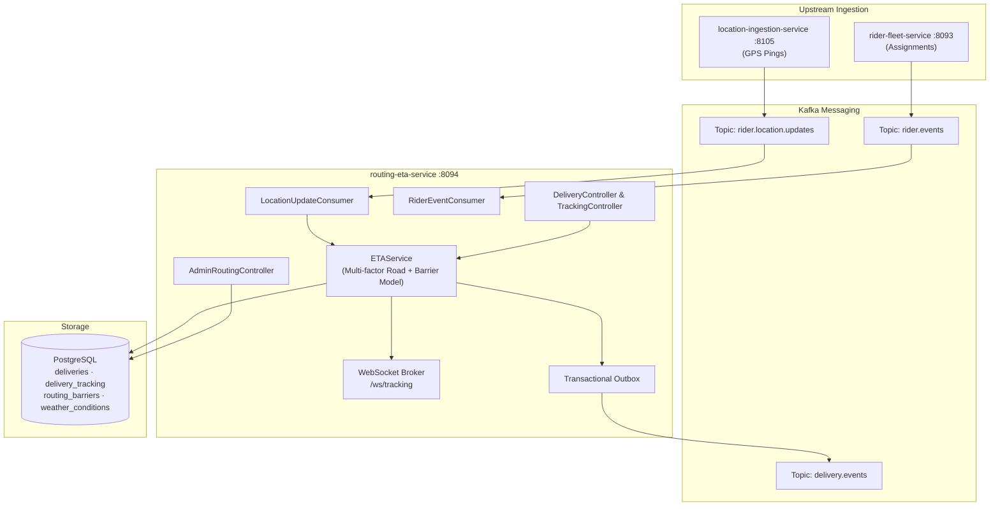

# Routing & ETA Service

## Overview

The `routing-eta-service` is the single source of truth for delivery lifecycle state, route optimization, dynamic ETA calculation, and real-time rider tracking in InstaCommerce. It consumes high-frequency rider GPS updates from Kafka, applies multi-factor physics and detour heuristics, tracks SLA breach risks, and broadcasts live tracking updates via WebSocket to customer clients.

- **Ownership:** Fulfillment & Logistics Engineering (`@instacommerce/logistics-team`)
- **Language / Runtime:** Java 21 / Spring Boot 4.0.0 (Spring MVC & WebSocket)
- **Canonical Port:** `8094` (`server.port: ${SERVER_PORT:8094}`)
- **Readiness Probe:** `http://localhost:8094/actuator/health/readiness`
- **Liveness Probe:** `http://localhost:8094/actuator/health/liveness`
- **Metrics:** `http://localhost:8094/actuator/prometheus`
- **Database:** PostgreSQL 15+ (partitioned telemetry, barrier zones, outbox pattern)
- **Status:** Tier 1 Critical (Customer delivery visibility and SLA guarantees)

---

## Service Responsibilities & Domain Rules

1. **Delivery Lifecycle State Machine:** Owns transitions across `PENDING`, `PICKED_UP`, `NEAR_DESTINATION`, `DELIVERED`, and `FAILED`.
2. **Dynamic Multi-Factor ETA Model:** Computes accurate ETAs using Haversine great-circle distance scaled by a road curvature factor (1.4x), vehicle speed baselines (bicycle 15 km/h, motorcycle 25 km/h, car 20 km/h), peak hour congestion (0.75x), night speed boosts (1.1x), weather penalty multipliers, and routing barrier detours.
3. **Live GPS Tracking & Geofencing:** Ingests rider location updates from `rider.location.updates` and automatically transitions delivery state to `NEAR_DESTINATION` when distance drops below 200 meters (0.2 km).
4. **SLA Breach Monitoring & Auto-Compensation:** Detects when predicted ETA exceeds promised delivery windows, flags breach risk (`is_breach_risk`), and triggers compensation calculation for customer reassurance.
5. **Real-Time WebSocket Broadcast:** Fans out sanitized GPS coordinates, heading, speed, and remaining minutes to active tracking sessions on `/ws/tracking`.

---

## Architecture and Integration



---

## Database Schema & Migrations

Managed by **Flyway** (`src/main/resources/db/migration/` V1 through V10):

| Migration | File | Tables / Objects | Description |
|---|---|---|---|
| `V1` | `V1__create_deliveries.sql` | `deliveries` | Delivery records with pickup/dropoff coordinates, order link, status, and SLA estimates |
| `V2` | `V2__create_delivery_tracking.sql` | `delivery_tracking` | Time-series GPS tracking points with coordinates, speed, heading, and recorded timestamp |
| `V3` | `V3__create_outbox_events.sql` | `outbox_events` | Transactional outbox table for reliable CDC domain event publishing |
| `V4` | `V4__create_shedlock.sql` | `shedlock` | Distributed locking table for background retention and partition jobs |
| `V5` | `V5__partition_delivery_tracking.sql` | `delivery_tracking` | Range-partitioning by month on `recorded_at` with dynamic monthly partition generation |
| `V6` | `V6__add_delivery_indexes.sql` | Indexes | Performance indexes on `status`, `rider_id`, and `order_id` |
| `V7` | `V7__add_outbox_envelope_fields.sql` | `outbox_events` | Envelope metadata: `event_id`, `correlation_id`, `causation_id`, `schema_version` |
| `V8` | `V8__add_outbox_retention_index.sql` | `outbox_events` | Retention cleanup index `idx_outbox_events_retention` on `(processed_at, created_at)` |
| `V9` | `V9__add_routing_barriers_and_weather.sql` | `routing_barriers`, `weather_conditions`, `traffic_congestion_feeds` | Environmental factors: flood/construction barriers, store monsoon multipliers, zone traffic feeds |
| `V10` | `V10__add_delivery_compensation_and_vehicle.sql` | `deliveries` | SLA breach compensation fields (`is_breach_risk`, `compensation_amount_cents`, `vehicle_type`) |

---

## API Reference

### Public / Customer Endpoints (`/deliveries`, `/tracking`)

| Method | Path | Auth | Description |
|---|---|---|---|
| `GET` | `/deliveries/{orderId}` | JWT | Look up active delivery state and coordinates by order UUID |
| `GET` | `/deliveries/{id}/eta` | JWT | Fetch real-time dynamic ETA and distance calculation |
| `GET` | `/deliveries/{id}/tracking` | JWT | Retrieve historical GPS breadcrumbs for delivery route playback |
| `POST` | `/tracking/location` | JWT | Direct ingestion of rider GPS coordinate |

### Admin Endpoints (`/admin/routing`)

| Method | Path | Role | Description |
|---|---|---|---|
| `POST` | `/admin/routing/barriers` | `ADMIN` | Register dynamic routing barrier (construction, flooding) with detour penalty |
| `GET` | `/admin/routing/barriers` | `ADMIN` | List all active geographical barriers |
| `DELETE` | `/admin/routing/barriers/{id}` | `ADMIN` | Deactivate routing barrier |
| `POST` | `/admin/routing/weather` | `ADMIN` | Update store weather condition and speed penalty multiplier |
| `GET` | `/admin/routing/weather/{storeId}` | `ADMIN` | Get active weather factor for dark store |
| `POST` | `/admin/routing/traffic` | `ADMIN` | Set real-time congestion factor for municipal traffic zone |
| `GET` | `/admin/routing/traffic/{zoneId}` | `ADMIN` | Get congestion factor for traffic zone |

### WebSocket Live Tracking

- **Endpoint:** `/ws/tracking` (STOMP over SockJS)
- **Topic Subscription:** `/topic/delivery/{deliveryId}`
- **Broadcast Payload:**
  ```json
  {
    "deliveryId": "3fa85f64-5717-4562-b3fc-2c963f66afa6",
    "latitude": 12.9716,
    "longitude": 77.5946,
    "speedKmh": 28.5,
    "heading": 182.0,
    "estimatedMinutes": 8,
    "status": "PICKED_UP",
    "isNearDestination": false,
    "timestamp": "2026-10-31T01:00:00Z"
  }
  ```

---

## Outbox Events Emitted (`delivery.events`)

1. `DELIVERY_CREATED`: Delivery initialized for an order.
2. `DELIVERY_STATUS_UPDATED`: Transitioned to `PICKED_UP` or `NEAR_DESTINATION`.
3. `ETA_UPDATED`: Dynamic recalculation of arrival minutes.
4. `ETA_BREACH_RISK`: SLA threshold violated; triggers customer notification and compensation credit.
5. `DELIVERY_COMPLETED`: Rider successfully delivered order.
