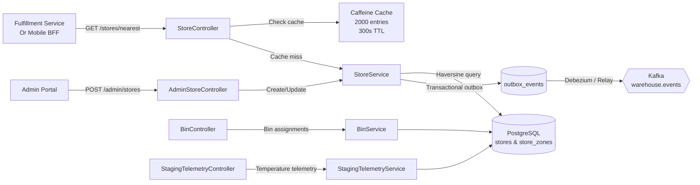

# Warehouse Service

## Overview

The warehouse-service is the operational authority for dark store registry, delivery zones, operating hours, capacity slots, warehouse bin locations, and staging cold-chain telemetry in InstaCommerce. It provides Haversine-based store discovery, store zone mapping, operating hours validation, and Caffeine-based caching for sub-300ms zone lookup latency. Enables fulfillment-service to optimize picking routes and supports real-time dark store capacity and status tracking.

**Service Ownership**: Platform Team - Store Ops
**Language**: Java 21 / Spring Boot 4.0
**Default Port**: 8092
**Status**: Tier 2 (Fulfillment path; operational criticality)
**Database**: PostgreSQL 15+ (decimal coordinates, Haversine nearest-store search)
**Cache**: Caffeine (JVM-local, 5-minute TTL)

## SLOs & Availability

- **Availability SLO**: 99.9% (43 minutes downtime/month)
- **P99 Latency**: < 300ms per query (with cache: < 50ms)
- **Error Rate**: < 0.1%
- **Store Lookup**: < 200ms uncached (Haversine distance query)
- **Zone Lookup**: < 50ms (heavily cached)
- **Max Throughput**: 5,000 queries/minute per pod

## Key Responsibilities

1. **Store Discovery**: Find nearest active dark store by lat/lng within radius using SQL Haversine distance
2. **Store Zones Management**: Pincode-to-store delivery zone mapping with delivery radius constraints
3. **Zone Lookup**: Fast cached lookup of zones for a given store
4. **Operating Hours**: Query store hours with timezone-aware open/close status checks
5. **Store Capacity**: Track hourly order slots with atomic PostgreSQL UPSERT increment
6. **Bin Location Management**: Track dark store aisle, rack, shelf, and bin assignments per SKU
7. **Cold-Chain Telemetry**: Ingest staging bay temperature telemetry and validate dispatch packaging constraints
8. **Outbox Events**: Publish `StoreCreated`, `StoreStatusChanged`, and `StoreDeleted` to `warehouse.events`

## Deployment

### GKE Deployment
- **Namespace**: default
- **Replicas**: 2 (Tier 2; operational fulfillment path)
- **CPU Request/Limit**: 500m / 1000m
- **Memory Request/Limit**: 512Mi / 1Gi
- **Readiness Probe**: `/actuator/health/readiness`
- **Liveness Probe**: `/actuator/health/liveness`

### Database
- **Name**: `warehouse` (PostgreSQL 15+)
- **Migrations**: Flyway (V1-V10) auto-applied
- **Connection Pool**: HikariCP 20 connections
- **Indexes**: Composite on (latitude, longitude), status, city, pincode

### Cache
- **Caffeine**: 2,000 entries max, 300s TTL (store metadata is stable)
- **Cache Namespaces**: `nearest-stores`, `store-zones`, `store-hours`

## Architecture

### Nearest Store Discovery Architecture

```
Client Request: Find nearest store to (12.9352, 77.6245) within 10km
        ↓
Cache Check: Caffeine nearest-stores namespace
   MISS → Native SQL Query
        ↓
PostgreSQL Haversine Formula:
  SELECT *, (6371 * acos(cos(radians(:lat)) * cos(radians(latitude)) *
            cos(radians(longitude) - radians(:lng)) +
            sin(radians(:lat)) * sin(radians(latitude)))) AS distance_km
  FROM stores
  WHERE latitude BETWEEN :lat - (:radiusKm / 111.0) AND :lat + (:radiusKm / 111.0)
    AND longitude BETWEEN :lng - (:radiusKm / (111.0 * cos(radians(:lat)))) AND :lng + (:radiusKm / (111.0 * cos(radians(:lat))))
    AND status = 'ACTIVE'
  ORDER BY distance_km ASC
  LIMIT 5
        ↓
Cache Result in Caffeine (300s TTL)
        ↓
Response: [{ storeId, name, distanceKm, address, hours }]
```

### Component Architecture



## Integrations

### Synchronous Clients
| Client | Endpoint | Timeout | Purpose |
|--------|----------|---------|---------|
| mobile-bff-service | GET /stores/nearest | 2s | Discover nearest dark store for customer |
| fulfillment-service | GET /stores/{id}/layout | 2s | Optimize picker route across aisles |
| fulfillment-service | GET /stores/{storeId}/bins/by-sku | 1s | Look up bin location for SKU during picking |
| admin-gateway-service | POST /admin/stores | 5s | Dark store administration and capacity configuration |

### Asynchronous Events
| Topic | Direction | Events |
|-------|-----------|--------|
| warehouse.events | Publish | StoreCreated, StoreStatusChanged, StoreDeleted |

## Data Model

### Core Tables

```sql
stores:
  id                       UUID PRIMARY KEY DEFAULT gen_random_uuid()
  name                     VARCHAR(255) NOT NULL
  address                  TEXT NOT NULL
  city                     VARCHAR(100) NOT NULL
  state                    VARCHAR(100) NOT NULL
  pincode                  VARCHAR(10) NOT NULL
  latitude                 DECIMAL(10, 8) NOT NULL
  longitude                DECIMAL(11, 8) NOT NULL
  status                   VARCHAR(30) NOT NULL DEFAULT 'ACTIVE'
  capacity_orders_per_hour INT NOT NULL DEFAULT 100
  timezone                 VARCHAR(50) NOT NULL DEFAULT 'Asia/Kolkata'
  version                  BIGINT NOT NULL DEFAULT 0
  max_concurrent_orders    INT NOT NULL DEFAULT 100
  current_pending_orders   INT NOT NULL DEFAULT 0
  created_at / updated_at  TIMESTAMPTZ NOT NULL DEFAULT now()

store_zones:
  id                  UUID PRIMARY KEY DEFAULT gen_random_uuid()
  store_id            UUID NOT NULL REFERENCES stores(id) ON DELETE CASCADE
  zone_name           VARCHAR(100) NOT NULL
  pincode             VARCHAR(10) NOT NULL
  delivery_radius_km  DECIMAL(5, 2) NOT NULL DEFAULT 5.00

warehouse_bins:
  id                  UUID PRIMARY KEY DEFAULT gen_random_uuid()
  store_id            UUID NOT NULL REFERENCES stores(id) ON DELETE CASCADE
  aisle, rack, shelf  VARCHAR(20) NOT NULL
  bin_number          VARCHAR(20) NOT NULL
  sku                 VARCHAR(100)
  max_volume_cm3      INT NOT NULL DEFAULT 50000
  current_volume_cm3  INT NOT NULL DEFAULT 0
  occupied            BOOLEAN NOT NULL DEFAULT FALSE

staging_temperature_telemetry:
  id                  UUID PRIMARY KEY DEFAULT gen_random_uuid()
  store_id            UUID NOT NULL REFERENCES stores(id) ON DELETE CASCADE
  sensor_id, bay_id   VARCHAR(50) NOT NULL
  storage_type        VARCHAR(20) NOT NULL
  temperature_celsius DECIMAL(5, 2) NOT NULL
  breached            BOOLEAN NOT NULL DEFAULT FALSE

outbox_events:
  id                  UUID PRIMARY KEY DEFAULT gen_random_uuid()
  event_id            UUID NOT NULL
  aggregate_type      VARCHAR(100) NOT NULL
  aggregate_id        VARCHAR(100) NOT NULL
  event_type          VARCHAR(100) NOT NULL
  schema_version      VARCHAR(20) NOT NULL DEFAULT 'v1'
  source_service      VARCHAR(100) NOT NULL DEFAULT 'warehouse-service'
  correlation_id      VARCHAR(255)
  payload             JSONB NOT NULL
  sent                BOOLEAN NOT NULL DEFAULT FALSE
  created_at          TIMESTAMPTZ NOT NULL DEFAULT now()
  capacity_units  INT DEFAULT 1000 (max items for picking)
  current_load    INT DEFAULT 0 (current items being picked)
  status          ENUM('ACTIVE', 'MAINTENANCE', 'FULL') DEFAULT 'ACTIVE'
  created_at      TIMESTAMP NOT NULL DEFAULT now()
  updated_at      TIMESTAMP NOT NULL DEFAULT now()

Indexes:
  - store_id, zone_code - query zones for store
  - store_id, status - active zones
  - UNIQUE (store_id, zone_code) - prevent duplicate zones
```

### Store Hours Table

```sql
store_hours:
  id              UUID PRIMARY KEY DEFAULT gen_random_uuid()
  store_id        UUID NOT NULL (FK → stores.id)
  day_of_week     INT NOT NULL (0=Sunday, 1=Monday, ..., 6=Saturday)
  open_time       TIME NOT NULL (e.g., 08:00)
  close_time      TIME NOT NULL (e.g., 22:00)
  is_closed       BOOLEAN DEFAULT FALSE (if true, store closed that day)
  created_at      TIMESTAMP NOT NULL

Indexes:
  - UNIQUE (store_id, day_of_week)
  - store_id - query hours for store
```

### Zone Capacity Table (for real-time tracking)

```sql
zone_capacity_tracking:
  id              UUID PRIMARY KEY
  zone_id         UUID NOT NULL (FK → store_zones.id)
  timestamp       TIMESTAMP NOT NULL
  current_load    INT NOT NULL
  load_percentage INT (current_load / capacity * 100)

Indexes:
  - zone_id, timestamp DESC (latest load)
```

## API Documentation

### Find Nearest Store

**GET /stores/nearest**
```bash
Query Parameters:
  latitude: double (required, e.g., 12.9352)
  longitude: double (required, e.g., 77.6245)
  radiusKm: double optional (default: 10)
  limit: int optional (default: 1, max: 5)

Example: /stores/nearest?latitude=12.9352&longitude=77.6245&radiusKm=15&limit=3

Response (200):
{
  "stores": [
    {
      "id": "store-uuid",
      "storeId": "STORE_001",
      "name": "Downtown Store",
      "address": "123 Main St, City",
      "city": "Bangalore",
      "distanceKm": 2.5,
      "status": "ACTIVE",
      "zones": [
        {
          "id": "zone-uuid",
          "code": "A",
          "name": "Zone A - Dry Goods",
          "currentLoad": 45,
          "capacity": 100,
          "status": "ACTIVE"
        }
      ],
      "hours": {
        "mondayOpen": "08:00",
        "mondayClose": "22:00"
      }
    }
  ]
}

Caching:
  - Key: "nearest-stores-{lat}-{lng}-{radius}"
  - TTL: 300s (store changes infrequent)
  - Hit rate: 80%+ (same areas searched repeatedly)
```

### Get Store Details

**GET /stores/{storeId}**
```bash
Response (200):
{
  "id": "store-uuid",
  "storeId": "STORE_001",
  "name": "Downtown Store",
  "address": "...",
  "location": { "latitude": 12.9352, "longitude": 77.6245 },
  "status": "ACTIVE",
  "zones": [
    { "id": "zone-uuid", "code": "A", "name": "Zone A", ... }
  ],
  "hours": [
    { "dayOfWeek": 1, "openTime": "08:00", "closeTime": "22:00" }
  ],
  "createdAt": "2025-01-01T00:00:00Z"
}

Caching:
  - Key: "stores:{storeId}"
  - TTL: 300s
```

### Get Store Zones

**GET /stores/{storeId}/zones**
```bash
Response (200):
{
  "storeId": "store-uuid",
  "zones": [
    {
      "id": "zone-uuid",
      "code": "A",
      "name": "Zone A - Dry Goods",
      "aisle": "Aisle 1",
      "shelfLevel": 2,
      "capacityUnits": 100,
      "currentLoad": 45,
      "status": "ACTIVE"
    }
  ]
}

Caching:
  - Key: "zones:{storeId}"
  - TTL: 300s
```

### Create Zone (Admin)

**POST /stores/{storeId}/zones**
```bash
Authorization: Bearer {JWT_TOKEN}
Content-Type: application/json

Request Body:
{
  "code": "FRIDGE",
  "name": "Refrigerated Goods",
  "aisle": "Aisle 5",
  "shelfLevel": 1,
  "capacityUnits": 200
}

Response (201 Created):
Side Effects: Cache invalidated for "zones:{storeId}"
```

### Curl Examples

```bash
# 1. Find nearest store (heavy hitter query)
curl -s 'http://warehouse-service:8090/stores/nearest?latitude=12.9352&longitude=77.6245&radiusKm=10' \
  -H "Authorization: Bearer $JWT_TOKEN" | jq '.stores[0].name'

# 2. Get store zones (for picking assignment)
curl -s http://warehouse-service:8090/stores/store-uuid/zones \
  -H "Authorization: Bearer $JWT_TOKEN" | jq '.zones | length'

# 3. Create store (admin)
curl -s -X POST http://warehouse-service:8090/stores \
  -H "Authorization: Bearer $ADMIN_JWT" \
  -H "Content-Type: application/json" \
  -d '{
    "storeId": "STORE_002",
    "name": "New Store",
    "address": "456 Main St",
    "latitude": 12.9400,
    "longitude": 77.6300
  }' | jq '.id'

# 4. Get store hours
curl -s http://warehouse-service:8090/stores/store-uuid/hours \
  -H "Authorization: Bearer $JWT_TOKEN" | jq '.hours'
```

## Error Handling & Resilience

### Geospatial Query Timeout

```yaml
resilience4j:
  timelimiter:
    instances:
      geoQuery:
        timeoutDuration: 2s
        cancelRunningFuture: true

  circuitbreaker:
    instances:
      postgisQueries:
        failureRateThreshold: 50%
        slowCallDurationThreshold: 2000ms
        waitDurationInOpenState: 30s
```

### Failure Scenarios

**Scenario 1: PostGIS Unavailable**
- Service uses stale cache (up to 300s old)
- Returns cached nearest stores
- Alert if cache miss + DB unavailable

**Scenario 2: Geospatial Index Corrupted**
- Queries become very slow (full table scan)
- Alert: Query latency p99 > 2000ms
- Recovery: REINDEX idx_stores_location; restart pod

**Scenario 3: Cache Expiration During High Load**
- Many simultaneous nearest-store queries
- Cache miss for same location → multiple DB queries
- Mitigation: Increase Caffeine size or TTL

## Monitoring & Observability

### Key Metrics

| Metric | Type | Alert Threshold |
|--------|------|-----------------|
| `warehouse.store_lookup.latency_ms` | Histogram (p50, p99) | p99 > 200ms |
| `warehouse.zone_lookup.latency_ms` | Histogram | p99 > 50ms |
| `cache.caffeine.hits` | Counter | N/A |
| `cache.caffeine.hitRate` | Gauge | < 75% = investigate |
| `warehouse.geospatial_query_duration_ms` | Histogram | p99 > 2000ms = alert |
| `warehouse.zone_capacity_full_count` | Gauge | N/A |

### Alert Rules (YAML)

```yaml
alerts:
  - name: WarehouseStoreLookupLatencyHigh
    condition: histogram_quantile(0.99, warehouse_store_lookup_latency_ms) > 200
    duration: 5m
    severity: SEV-2
    action: Alert; check PostGIS index health or cache effectiveness

  - name: WarehouseGeospatialQuerySlow
    condition: histogram_quantile(0.99, warehouse_geospatial_query_duration_ms) > 2000
    duration: 5m
    severity: SEV-2
    action: Investigate; possible index corruption or high DB load

  - name: WarehouseCacheHitRateLow
    condition: cache_caffeine_hitRate < 0.75
    duration: 10m
    severity: SEV-3
    action: Investigate; may indicate cache churn or diverse queries

  - name: WarehouseZoneCapacityFull
    condition: warehouse_zone_capacity_full_count > 5
    duration: 10m
    severity: SEV-3
    action: Alert ops team; zones at capacity; may need zone rebalancing

  - name: WarehousePostgisConnectionPoolExhausted
    condition: db_hikari_connections_active > 13 (of 15)
    duration: 5m
    severity: SEV-2
    action: Scale up or investigate slow queries
```

### Logging
- **INFO**: Store created/updated, zone added, capacity updated
- **WARN**: Zone full, geospatial query slow (>500ms), cache miss
- **ERROR**: DB unavailable, index corruption, unhandled exception
- **DEBUG**: Query details, index stats (disabled in prod)

### Tracing
- **Spans**: Nearest-store query, PostGIS execution, cache operations
- **Sampling**: 10% (read-heavy; non-critical)
- **Retention**: 1 day

## Security Considerations

### Authentication
- **Read APIs**: Public (GET /stores/nearest does not require auth)
- **Admin APIs**: Requires JWT + ADMIN role

### Data Protection
- **Sensitive Data**: Store addresses (public)
- **Geolocation**: Store coordinates (public for customer discovery)

### Known Risks
1. **Store Enumeration**: Attacker discovers all store locations via repeated queries → Mitigated by rate limiting at API gateway
2. **Competitor Intelligence**: Competitors scrape store locations → Mitigated by terms of service

## Troubleshooting

### Issue: Nearest Store Query Returns Wrong Store

**Diagnosis:**
```bash
# Verify Haversine calculation
kubectl logs -n fulfillment deployment/warehouse-service | grep -i "distance\|coordinate"

# Check PostGIS function
kubectl exec -n fulfillment pod/warehouse-service-0 -- psql -U postgres -d warehouse -c \
  "SELECT *, ST_Distance(location, ST_Point(77.6245, 12.9352)) as distance_m FROM stores ORDER BY distance_m LIMIT 5;"

# Verify stored coordinates
psql -d warehouse -c "SELECT store_id, ST_AsText(location) FROM stores LIMIT 5;"
```

**Resolution:**
- Verify coordinates are in correct lat/long format (not reversed)
- Check if geospatial index exists: `\d+ idx_stores_location`
- Rebuild index if corrupted: `REINDEX INDEX idx_stores_location;`

### Issue: Zone Lookup Cache Not Working (Latency High)

**Diagnosis:**
```bash
# Check cache metrics
curl http://localhost:8090/actuator/metrics/cache.caffeine.hitRate

# Check zone lookup latency
curl http://localhost:8090/actuator/metrics/warehouse.zone_lookup.latency_ms

# Verify zones are cached
kubectl exec pod/warehouse-service-0 -- \
  curl -s http://localhost:8090/stores/store-uuid/zones | jq '.zones | length'

# Check cache size
curl http://localhost:8090/actuator/metrics/cache.caffeine.size
```

**Resolution:**
- Increase Caffeine maximumSize if near limit
- Check if zones are frequently updated (invalidating cache)
- Verify cache TTL is set correctly (should be 300s)

### Issue: Store Hours Not Appearing Correctly

**Diagnosis:**
```bash
# Verify stored hours
psql -d warehouse -c "SELECT * FROM store_hours WHERE store_id='store-uuid';"

# Check if all 7 days are populated
psql -d warehouse -c "SELECT COUNT(DISTINCT day_of_week) FROM store_hours WHERE store_id='store-uuid';"

# Test API response
curl -s http://localhost:8090/stores/store-uuid/hours | jq '.hours'
```

**Resolution:**
- Ensure all 7 days (0-6) have hours entries
- Check if is_closed flag is set correctly
- Verify open_time < close_time (not wrapped midnight)

## Configuration

### Environment Variables
```env
# Server
SERVER_PORT=8090
SPRING_PROFILES_ACTIVE=gcp

# Database (with PostGIS)
SPRING_DATASOURCE_URL=jdbc:postgresql://cloudsql-proxy:5432/warehouse
SPRING_DATASOURCE_USERNAME=${DB_USER}
SPRING_DATASOURCE_PASSWORD=${DB_PASSWORD}
SPRING_DATASOURCE_HIKARI_POOL_SIZE=15

# Geospatial
POSTGIS_ENABLED=true
DEFAULT_RADIUS_KM=10
MAX_NEARBY_RESULTS=5

# Cache
CACHE_TTL_SECONDS=300
CACHE_MAX_SIZE=2000

# Tracing
OTEL_EXPORTER_OTLP_TRACES_ENDPOINT=http://otel-collector.monitoring:4318/v1/traces
```

### application.yml
```yaml
server:
  port: 8090
spring:
  jpa:
    hibernate:
      ddl-auto: none
  cache:
    caffeine:
      spec: maximumSize=2000,expireAfterWrite=300s
    cache-names:
      - stores
      - store-zones
      - store-hours

warehouse-service:
  geospatial:
    default-radius-km: 10
    max-results: 5
  cache:
    ttl-seconds: 300
    enabled: true
```

## Kubernetes Deployment

```yaml
apiVersion: apps/v1
kind: Deployment
metadata:
  name: warehouse-service
  namespace: fulfillment
spec:
  replicas: 2
  selector:
    matchLabels:
      app: warehouse-service
  template:
    metadata:
      labels:
        app: warehouse-service
      annotations:
        prometheus.io/scrape: "true"
        prometheus.io/port: "8090"
    spec:
      containers:
      - name: warehouse-service
        image: warehouse-service:v1.2.3
        ports:
        - containerPort: 8090
          name: http
        env:
        - name: SPRING_PROFILES_ACTIVE
          value: gcp
        resources:
          requests:
            cpu: 500m
            memory: 512Mi
          limits:
            cpu: 1000m
            memory: 1Gi
        livenessProbe:
          httpGet:
            path: /actuator/health/live
            port: 8090
          initialDelaySeconds: 10
        readinessProbe:
          httpGet:
            path: /actuator/health/ready
            port: 8090
          initialDelaySeconds: 15
---
apiVersion: v1
kind: Service
metadata:
  name: warehouse-service
  namespace: fulfillment
spec:
  selector:
    app: warehouse-service
  ports:
  - port: 8090
    targetPort: 8090
  type: ClusterIP
```

## Related Documentation

- **Wave 38**: SLOs and observability
- **ADR-003**: Geospatial Queries and PostGIS Integration
- [High-Level Design](diagrams/hld.md)
- [Low-Level Architecture](diagrams/lld.md)
- [Database Schema (ERD)](diagrams/erd.md)
- [Runbook](runbook.md)