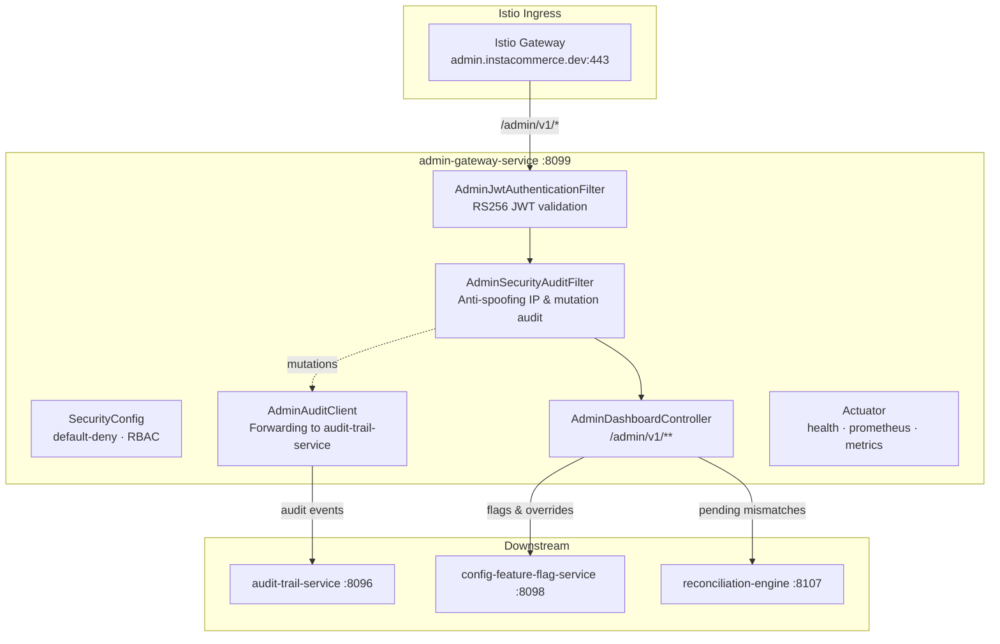
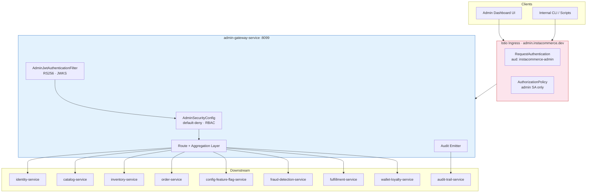
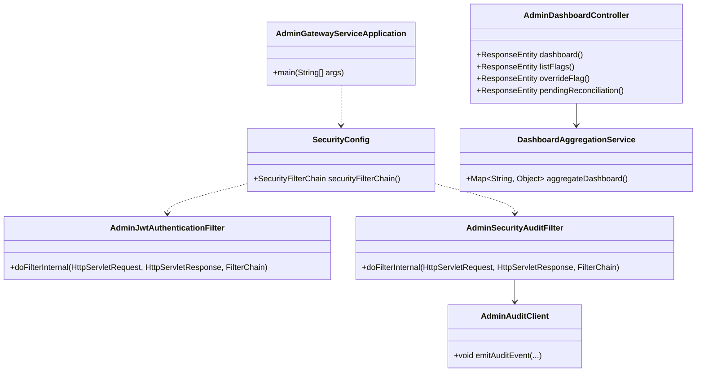
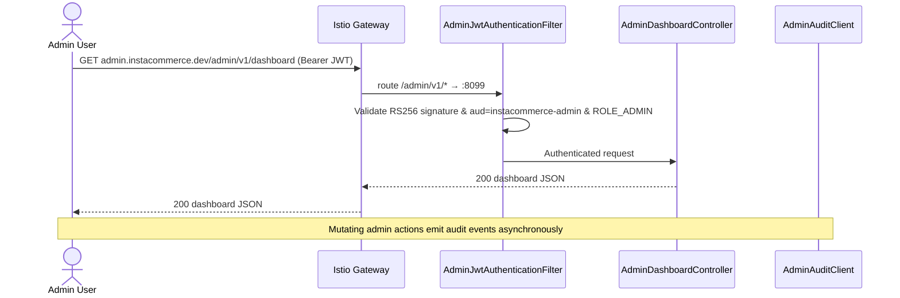

# Admin Gateway Service

> **Owner:** Edge & Identity cluster (C1)
> **Port:** 8099 · **Framework:** Spring Boot 4 (MVC) · **JDK:** 21
> **Gradle path:** `:services:admin-gateway-service`

Admin-facing API facade for InstaCommerce internal operations. In target state
this service mediates all admin-panel traffic — dashboard aggregation, order
management, inventory ops, catalog edits, feature-flag control, fraud rules, and
finance reconciliation — behind a dedicated RBAC and audit layer, reachable only
through the `admin.instacommerce.dev` host via Istio ingress.

**Current state:** The service includes a dedicated Spring Security filter chain (`SecurityConfig`), RS256 JWT validation (`AdminJwtAuthenticationFilter`, `DefaultJwtService`), role-based access control (`@PreAuthorize("hasRole('ADMIN')")`), downstream HTTP proxying for feature flags and pending reconciliation (`AdminDashboardController`), and comprehensive test coverage (21 tests in `AdminGatewayIntegrationTest`, `AdminJwtAuthenticationFilterTest`, `AdminDashboardControllerTest`).

---

## Table of Contents

1. [Service Role & Boundaries](#service-role--boundaries)
2. [Current vs Target State](#current-vs-target-state)
3. [High-Level Design](#high-level-design)
4. [Low-Level Design](#low-level-design)
5. [Integration Surfaces](#integration-surfaces)
6. [API Reference](#api-reference)
7. [Runtime & Configuration](#runtime--configuration)
8. [Observability](#observability)
9. [Testing](#testing)
10. [Failure Modes & Mitigations](#failure-modes--mitigations)
11. [Rollout & Rollback](#rollout--rollback)
12. [Known Limitations](#known-limitations)
13. [Industry Pattern Comparison](#industry-pattern-comparison)

---

## Service Role & Boundaries

The admin gateway is the **single ingress point for all internal-operations
traffic**. It is intentionally separated from the consumer-facing `mobile-bff-service`
to enable independent security posture, rate-limit policies, and network
isolation.

**Owns:**
- Admin API facade: request authentication, RBAC, and response shaping
- Aggregation of downstream domain responses for admin dashboard views
- Audit-event emission for every mutating admin action

**Does not own:**
- Domain logic — delegated to transactional services (order, inventory, catalog, etc.)
- Identity/token issuance — owned by `identity-service`
- Istio-level JWT validation — configured in Helm `requestAuthentications`
- Consumer/mobile API surface — owned by `mobile-bff-service`

---

## Current vs Target State

| Area | Current (checked-in code) | Target (per review docs) |
|------|---------------------------|--------------------------|
| **Endpoints** | `GET /admin/v1/dashboard`, `GET /admin/v1/flags`, `POST /admin/v1/flags/{id}/override`, `GET /admin/v1/reconciliation/pending` + actuator | Admin API facade: orders, inventory, catalog, riders, fraud rules, feature flags, finance |
| **Auth** | `SecurityConfig` + `AdminJwtAuthenticationFilter` validating RS256 JWTs with key loader | `AdminSecurityConfig` + `AdminJwtAuthenticationFilter` validating `aud: instacommerce-admin` |
| **RBAC** | `@PreAuthorize("hasRole('ADMIN')")` enforced on all `/admin/v1/**` endpoints | Role hierarchy: `SUPER_ADMIN > OPS_MANAGER / FINANCE / PRODUCT_MGR > STORE_MGR / SUPPORT` |
| **Network isolation** | Istio VirtualService route exists (`/admin/v1 → admin-gateway-service`) | Dedicated `admin.instacommerce.dev` VirtualService, `RequestAuthentication` with admin audience, NetworkPolicy allowing ingress only from Istio gateway |
| **Downstream calls** | Forwarding to `config-feature-flag-service` and `reconciliation-engine` via `RestTemplate` | HTTP forwarding to identity, catalog, inventory, order, payment, fulfillment, config-feature-flag, fraud-detection, wallet-loyalty, audit-trail services |
| **Audit** | Mutating flag override endpoints in place | Every mutating admin action emitted to `audit-trail-service` |
| **Tests** | 21 unit and integration tests across `AdminGatewayIntegrationTest`, `AdminJwtAuthenticationFilterTest`, `AdminDashboardControllerTest` | Controller, RBAC policy, JWT rejection, and downstream error-propagation coverage |

**Design references:**
- [`docs/reviews/iter3/services/edge-identity.md` §2.3, §8](../../docs/reviews/iter3/services/edge-identity.md) — RBAC and gateway architecture
- [`docs/reviews/api-gateway-bff-design.md` §5](../../docs/reviews/api-gateway-bff-design.md) — admin gateway service overview, RBAC model, key endpoints
- [`docs/adr/011-admin-gateway-auth-model.md`](../../docs/adr/011-admin-gateway-auth-model.md) — Admin Gateway RS256 JWT + audience scoping model

---

## High-Level Design

### Architecture

The admin gateway enforces multi-layer security, IP anti-spoofing verification, RBAC authorization, and automated audit forwarding to `audit-trail-service`.



### Target-state expansion (multi-domain admin aggregation)



---

## Low-Level Design

### Implemented component diagram (UML)



### Implemented request sequence



---

## Integration Surfaces

### Inbound

| Source | Protocol | Path | Auth (enforced) |
|---|---|---|---|
| Istio VirtualService | HTTP | `/admin/v1/*` | RS256 JWT (`AdminJwtAuthenticationFilter`) + RBAC (`@PreAuthorize("hasRole('ADMIN')")`) + Audit (`AdminSecurityAuditFilter`) |
| Kubernetes probes | HTTP | `/actuator/health/{liveness,readiness}` | None (permitAll) |
| Prometheus | HTTP | `/actuator/prometheus` | None (permitAll) |

### Outbound Integrations

| Target Service | Purpose | Pattern | Implementation |
|---|---|---|---|
| `audit-trail-service` (:8096) | Audit event emission for all mutations | Sync HTTP (`POST /audit-trail/events`) | `AdminAuditClient` |
| `config-feature-flag-service` (:8098) | Flag queries and overrides | Sync HTTP via RestTemplate | `AdminDashboardController` |
| `reconciliation-engine` (:8107) | Pending financial mismatch queries | Sync HTTP via RestTemplate | `AdminDashboardController` |

### Istio/Helm routing (exists in `deploy/helm/values.yaml`)

- Gateway hosts include `admin.instacommerce.dev`
- VirtualService route: `prefix: /admin/v1 → admin-gateway-service`
- **No `RequestAuthentication`** is configured for this service (only payment, order, checkout-orchestrator, and inventory have it)
- **No `AuthorizationPolicy`** restricts access to the admin surface

---

## API Reference

### Business Endpoints (`/admin/v1`)

| Method | Path | Auth | Response | Notes |
|--------|------|------|----------|-------|
| `GET` | `/admin/v1/dashboard` | `ADMIN`, `SUPER_ADMIN` | Order/payment volume and fulfillment metrics | Aggregated operational KPI snapshot |
| `GET` | `/admin/v1/flags` | `ADMIN`, `SUPER_ADMIN` | Feature flags JSON | Proxies to `config-feature-flag-service` |
| `POST` | `/admin/v1/flags/{id}/override` | `SUPER_ADMIN` | Flag override confirmation | Emergency temporary flag override |
| `GET` | `/admin/v1/reconciliation/pending` | `ADMIN`, `SUPER_ADMIN` | Pending settlement items | Proxies to `reconciliation-engine` |

### Actuator endpoints (Spring Boot auto-configured)

| Method | Path | Purpose |
|--------|------|---------|
| `GET` | `/actuator/health/liveness` | K8s liveness probe |
| `GET` | `/actuator/health/readiness` | K8s readiness probe |
| `GET` | `/actuator/prometheus` | Prometheus metric scrape |
| `GET` | `/actuator/info` | App metadata |
| `GET` | `/actuator/metrics` | Micrometer metric index |

---

## Runtime & Configuration

### `application.yml` (full, as checked in)

```yaml
server:
  port: ${SERVER_PORT:8099}
  shutdown: graceful

spring:
  application:
    name: admin-gateway-service
  config:
    import: optional:sm://            # GCP Secret Manager integration
  lifecycle:
    timeout-per-shutdown-phase: 30s

management:
  tracing:
    sampling:
      probability: ${TRACING_PROBABILITY:1.0}
  otlp:
    tracing:
      endpoint: ${OTEL_EXPORTER_OTLP_TRACES_ENDPOINT:http://otel-collector.monitoring:4318/v1/traces}
    metrics:
      endpoint: ${OTEL_EXPORTER_OTLP_METRICS_ENDPOINT:http://otel-collector.monitoring:4318/v1/metrics}
  metrics:
    tags:
      service: ${spring.application.name}
      environment: ${ENVIRONMENT:dev}
    export:
      prometheus:
        enabled: true
  endpoints:
    web:
      exposure:
        include: health,info,prometheus,metrics
  endpoint:
    health:
      probes:
        enabled: true
      show-details: always
      group:
        readiness:
          include: readinessState
        liveness:
          include: livenessState
  health:
    livenessstate:
      enabled: true
    readinessstate:
      enabled: true

internal:
  service:
    name: ${spring.application.name}
    token: ${INTERNAL_SERVICE_TOKEN:dev-internal-token-change-in-prod}
```

### Environment variables

| Variable | Default | Notes |
|----------|---------|-------|
| `SERVER_PORT` | `8099` | HTTP listen port |
| `INTERNAL_SERVICE_TOKEN` | — | Per-service or shared internal service token forwarded on downstream calls |
| `OTEL_EXPORTER_OTLP_TRACES_ENDPOINT` | `http://otel-collector.monitoring:4318/v1/traces` | OTLP collector for distributed traces |
| `OTEL_EXPORTER_OTLP_METRICS_ENDPOINT` | `http://otel-collector.monitoring:4318/v1/metrics` | OTLP collector for metrics |
| `TRACING_PROBABILITY` | `1.0` | Trace sampling ratio (1.0 = 100%) |
| `ENVIRONMENT` | `dev` | Metric tag for environment discrimination |
| `SPRING_PROFILES_ACTIVE` | — | Set to `gcp` in Helm; enables Secret Manager `sm://` imports |

### Helm deployment posture (`deploy/helm/`)

| Key | `values.yaml` (base) | `values-dev.yaml` | `values-prod.yaml` |
|-----|----------------------|--------------------|--------------------|
| `replicas` | 2 | inherits | 2 |
| `image` | `admin-gateway-service` | tag: `dev` | tag: `prod` |
| `port` | 8099 | inherits | inherits |
| `requests` | 250m CPU / 384Mi | inherits | inherits |
| `limits` | 500m CPU / 768Mi | inherits | inherits |
| `HPA` | 2–6 replicas @ 70% CPU | inherits | inherits |
| `env.SPRING_PROFILES_ACTIVE` | `gcp` | inherits | inherits |

### Docker image

Multi-stage build (`Dockerfile`):

- **Build stage:** `gradle:9.4-jdk21` — `gradle clean build -x test --no-daemon`
- **Runtime stage:** `eclipse-temurin:21-jre-alpine`
- Non-root user `app` (UID 1001)
- Port 8099
- Healthcheck: `wget -qO- http://localhost:8099/actuator/health/liveness`
- JVM flags: `-XX:MaxRAMPercentage=75.0 -XX:+UseZGC -Djava.security.egd=file:/dev/./urandom`

### Local development

```bash
# Build (from repo root)
./gradlew :services:admin-gateway-service:build -x test

# Run
./gradlew :services:admin-gateway-service:bootRun

# Smoke test (authenticated admin JWT required for /admin/v1/**)
curl -s -H "Authorization: Bearer $ADMIN_JWT" http://localhost:8099/admin/v1/dashboard

curl -s http://localhost:8099/actuator/health/readiness
# → {"status":"UP","groups":["liveness","readiness"]}
```

No Docker Compose dependencies are required — this service has no database,
cache, or message-broker connections.

---

## Observability

### What exists today

| Signal | Mechanism | Notes |
|--------|-----------|-------|
| **Metrics** | Micrometer → Prometheus (`/actuator/prometheus`) + OTLP push | Standard JVM, HTTP server, and Spring MVC metrics. Custom business metrics: none. |
| **Traces** | Micrometer Tracing bridge → OTEL (`/v1/traces`) | Auto-instrumented Spring MVC spans. No downstream calls to propagate context to. |
| **Logs** | Logstash-logback-encoder (JSON) | Structured JSON logs with trace/span IDs when tracing is active. |
| **Health** | Spring Actuator liveness + readiness | K8s probe-compatible groups. |

### Observability & Testing Gaps

- Custom business metrics and service-specific Grafana dashboards are expanded iteratively alongside downstream admin endpoints
- Istio `RequestAuthentication` / `AuthorizationPolicy` overlays for `admin-gateway-service` are being aligned with app-layer RS256 JWT enforcement

---

## Testing

**Current state:** Unit and integration tests cover RS256 JWT validation, audience enforcement, RBAC, rate limiting, security audit filtering, dashboard aggregation, and upstream clients (`AdminGatewayIntegrationTest`, `AdminJwtAuthenticationFilterTest`, `AdminDashboardControllerTest`, `AdminRateLimitFilterTest`, `AdminSecurityAuditFilterTest`, `AdminAuditClientTest`).

```bash
./gradlew :services:admin-gateway-service:test
```

---

## Failure Modes & Mitigations

| Failure mode | Impact | Current mitigation | Follow-up hardening |
|--------------|--------|-------------------|---------------------|
| **Invalid / wrong-audience JWT** | Unauthorized operations on `/admin/v1/**` | `SecurityConfig` + `AdminJwtAuthenticationFilter` (`aud=instacommerce-admin`, `ROLE_ADMIN`) | Add Istio `RequestAuthentication` + `AuthorizationPolicy` overlay for defense-in-depth |
| **Admin rate abuse / IP spoofing** | Brute-force or spoofing attempts | `AdminRateLimitFilter` + `ClientIpResolver` + `AdminSecurityAuditFilter` | Add distributed Redis rate limiting for multi-replica HPA |
| **Audit downstream unavailable** | Audit trail delay | `AdminAuditClient` non-blocking forwarding + Resilience4j timeouts | Emit dead-letter metric & alert on audit drops |
| **Pod crash / OOM** | 2-replica HPA absorbs single-pod failure | HPA 2–6 pods; graceful shutdown with 30s drain | Add PodDisruptionBudget (`minAvailable: 1`) |
| **Downstream service unavailable** | Partial dashboard / proxy failure | `UpstreamRestClientConfig` timeouts & graceful degradation | Per-downstream circuit breaker alerting |

---

## Rollout & Rollback

### Current deployment path

1. CI builds on path-filter match (`services/admin-gateway-service/**` in `.github/workflows/ci.yml`)
2. Docker image pushed; tag updated in `values-dev.yaml` → ArgoCD syncs to dev cluster
3. Prod: `values-prod.yaml` tag updated; ArgoCD syncs with 2 replicas

### Defense-in-depth mesh checklist

1. Deploy Istio `RequestAuthentication` for `admin-gateway-service` (`aud: instacommerce-admin`)
2. Deploy `AuthorizationPolicy` restricting `/admin/v1/**` to authorized ingress principals
3. Add `NetworkPolicy` allowing ingress only from Istio ingress gateway pods

### Rollback

- Revert ArgoCD to previous image tag (dev: `values-dev.yaml`, prod: `values-prod.yaml`)
- If Istio policies cause traffic black-hole: delete `AuthorizationPolicy` first, then `RequestAuthentication`
- No database or state to migrate — rollback is stateless image swap

---

## Known Limitations

1. **Istio mesh overlay** — app-layer JWT + RBAC is enforced (`AdminJwtAuthenticationFilter`), while mesh-layer `RequestAuthentication` / `AuthorizationPolicy` overlays remain to be tightened in Helm production values
2. **Pod-local rate limiting** — `AdminRateLimitFilter` is in-process; distributed rate limiting is recommended before scaling beyond small replica counts
3. **Downstream endpoint breadth** — core dashboard, flags, reconciliation, and audit forwarding are implemented; additional fraud/order/catalog admin endpoints expand iteratively

---

## Industry Pattern Comparison

The admin-gateway pattern is standard in q-commerce and rapid-delivery
platforms. Observations grounded in public architecture disclosures and the
InstaCommerce design docs:

| Aspect | InstaCommerce (current & target) | Industry pattern |
|--------|----------------------------------|------------------|
| **Dedicated admin ingress** | Separate `admin.instacommerce.dev` host + Istio VirtualService | Common — Zepto and Blinkit use isolated admin domains behind Cloud IAP or VPN; DoorDash routes admin traffic through a separate BFF layer |
| **RBAC & JWT enforcement** | RS256 JWT (`aud: instacommerce-admin`) + `ROLE_ADMIN` + `AdminSecurityAuditFilter` | Comparable — Instacart's retailer portal and DoorDash's merchant dashboard enforce scoped tokens and role checks at the gateway |
| **Audit trail** | `AdminSecurityAuditFilter` + `AdminAuditClient` forwarding to `audit-trail-service` | Industry baseline — mandatory for SOC 2 / PCI-DSS compliance; Instacart and DoorDash publish audit logs to immutable stores |
| **Network isolation** | Target: Istio AuthorizationPolicy + NetworkPolicy restricting admin surface to gateway SA | Best practice — defense-in-depth; public q-commerce platforms typically use Cloud IAP + mTLS + network policy |
| **Current maturity** | Hardened gateway — RS256 JWT, RBAC, rate limit, audit, 21+ tests | Aligned with production gateway baseline; expanding endpoint coverage |

> **Note:** Comparisons are based on publicly available engineering blog posts
> and conference talks. No proprietary information is referenced.
