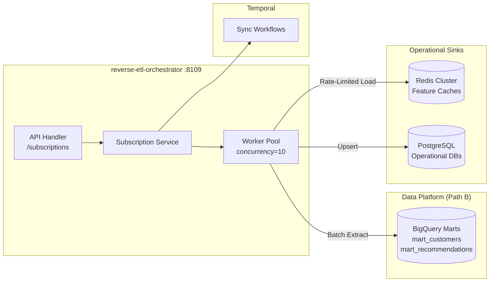

# Reverse ETL Orchestrator Service (`reverse-etl-orchestrator`)

> **Port:** 8109 (API) · 8110 (Health) · 9090 (Metrics) · **Language:** Go 1.25 / 1.24  
> **Role:** Orchestrates data synchronization between analytical data stores (BigQuery / data mesh data products) and operational systems (PostgreSQL, Redis) across InstaCommerce.

---

## 1. Overview & Service Role

The `reverse-etl-orchestrator` manages reverse ETL pipelines, subscription configurations, schema transformations, and sink activations for the InstaCommerce data mesh platform.

### Key Capabilities
- **Subscription Lifecycle**: Declaratively registers and manages downstream service subscriptions to curated BigQuery data products (`mart_customers`, `mart_recommendations`, `mart_fraud_scores`).
- **Worker Pool Synchronization**: Runs a concurrent worker pool to batch-sync analytical features into operational Redis and PostgreSQL caches with rate limiting.
- **Temporal Workflow Coordination**: Dispatches long-running, fault-tolerant reverse ETL sync jobs to Temporal.
- **Observability**: Exposes Prometheus metrics, OTel tracing, and structured JSON logs.

---

## 2. High-Level Architecture



---

## 3. Network Ports & Addresses

| Endpoint | Environment Variable | Default | Description |
|---|---|---|---|
| **API** | `API_ADDR` | `:8109` | REST API for managing subscriptions and sinks |
| **Health** | `HEALTH_ADDR` | `:8110` | Liveness & readiness probes (`/health`, `/health/live`, `/health/ready`) |
| **Metrics** | `METRICS_ADDR` | `:9090` | `/metrics` Prometheus scrape endpoint |

---

## 4. API Reference

All routes are mounted on the API listener (`:8109`) under `/api/v1`:

| Method | Endpoint | Description |
|---|---|---|
| `GET` | `/api/v1/subscriptions` | List subscriptions (supports `source_domain`, `sink_type`, `state` query filters) |
| `POST` | `/api/v1/subscriptions` | Create a new reverse ETL subscription |
| `GET` | `/api/v1/subscriptions/{id}` | Retrieve subscription details by ID |
| `DELETE` | `/api/v1/subscriptions/{id}` | Archive a subscription |
| `POST` | `/api/v1/subscriptions/{id}/activate` | Activate an inactive or paused subscription |
| `POST` | `/api/v1/subscriptions/{id}/pause` | Pause an active synchronization pipeline |
| `GET` | `/health` | API listener health status |

---

## 5. Runtime Configuration

| Variable | Default | Description |
|---|---|---|
| `API_ADDR` | `:8109` | Main HTTP API listen address |
| `HEALTH_ADDR` | `:8110` | Dedicated probe server address |
| `METRICS_ADDR` | `:9090` | Prometheus metrics scrape address |
| `DATABASE_URL` | `postgres://localhost:5432/reverse_etl?sslmode=disable` | PostgreSQL connection string |
| `KAFKA_BROKERS` | `localhost:9092` | Kafka broker endpoints |
| `KAFKA_CONSUMER_GROUP` | `reverse-etl-orchestrator` | Consumer group ID |
| `TEMPORAL_HOST` | `localhost:7233` | Temporal server gRPC host:port |
| `TEMPORAL_NAMESPACE` | `reverse-etl` | Temporal namespace |
| `REDIS_ADDR` | `localhost:6379` | Operational Redis sink address |
| `REDIS_PASSWORD` | `""` | Redis auth password |
| `REDIS_DB` | `0` | Target Redis database index |
| `WORKER_POOL_CONCURRENCY` | `10` | Concurrent worker goroutines for batch processing |
| `SYNC_RATE_LIMIT_PER_SEC` | `1000` | Max record write throughput to operational sinks |
| `SERVICE_VERSION` | `1.0.0` | Semantic version string |
| `ENVIRONMENT` | `development` | Deployment environment (`dev`, `staging`, `prod`) |

---

## 6. Local Development & Testing

```bash
# Run unit and handler tests
cd services/reverse-etl-orchestrator
go test -race ./...

# Build binary
go build -o reverse-etl-orchestrator ./cmd/server
```

---

## 7. CI/CD & GitOps Alignment

- **CI Pipeline**: Evaluated under `all_go_services` matrix in `.github/workflows/ci.yml`.
- **Helm Release**: Deployed via Helm values in `deploy/helm/values.yaml` under `services.reverse-etl-orchestrator`.
- **Database Bootstrap**: Initialized in `scripts/init-dbs.sql` with both `reverse_etl` and `reverse_etl_db` schemas.
